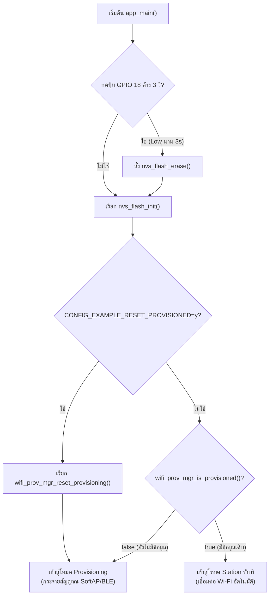
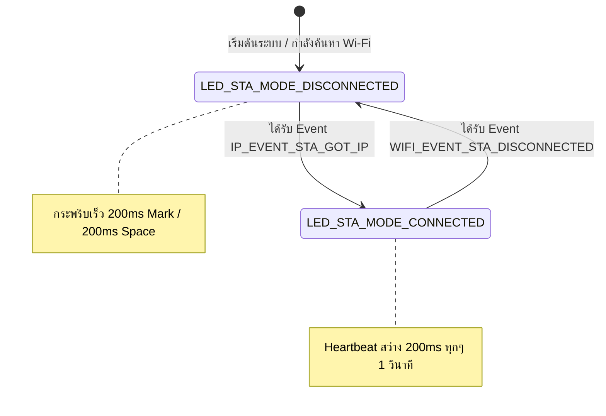

### ผลลัพธ์จาก Serial Monitor (ESP-IDF Console)

```text
I (520) LAB7_1_RESET: Checking Factory Reset Button on GPIO 18...
W (530) LAB7_1_RESET: Factory reset button pressed. Hold for 3000 ms to confirm...
W (3540) LAB7_1_RESET: Factory reset confirmed! Erasing NVS Flash...
I (3550) nvs: Partition 'nvs' erased successfully.
I (3570) LAB7_1_RESET: Initializing NVS partition at offset 0x9000
I (3580) wifi_prov_mgr: Provisioning state: unprovisioned
I (3590) LAB7_1_RESET: Starting provisioning (Ready for SoftAP / BLE)
```

---

### ผังงานการทำงาน (Flowchart & State Diagram)

#### ภารกิจที่ 1: ผังงานการตัดสินใจช่วง Bootstrapping & Reset Decision



#### ภารกิจที่ 2: ผังสถานะการเปลี่ยนจังหวะไฟ LED 1 (Wi-Fi STA Indicator)



---

### ตารางบันทึกผลการทดลอง

| รูปแบบการ Reset | คำสั่ง / พฤติกรรมที่ทำ | พฤติกรรมของ LED แต่ละดวงหลังเปิดเครื่อง | สถานะใน Serial Monitor |
| :--- | :--- | :--- | :--- |
| **1. CLI Erase** | `idf.py erase-flash` | LED แสดงสถานะรอรับ Provisioning | Flash ถูกล้างทั้งชิป บอร์ดเข้าสู่ `Starting provisioning` แสดง QR Code |
| **2. Menuconfig Flag** | `CONFIG_EXAMPLE_RESET_PROVISIONED=y` | LED แสดงสถานะรอรับ Provisioning | Credentials ถูกล้างอัตโนมัติทุกครั้งที่บูต เข้าสู่ `Starting provisioning` |
| **3. Hardware Button (GPIO 18)** | กดปุ่ม GPIO 18 ค้าง 3 วินาที | LED กระพริบยืนยันการล้าง Flash | แสดง `Factory reset confirmed!` ล้าง NVS Partition และเริ่ม Provisioning ใหม่ |

---

### คำถามท้ายการทดลอง (Post-Lab Questions)

#### 1. เพราะเหตุใดการกดปุ่ม BOOT (GPIO 0) ค้างไว้ในจังหวะรีเซ็ตบอร์ด จึงทำให้โปรแกรมค้างอยู่ที่ ROM Bootloader และไม่ยอมทำงานต่อ?
**ตอบ:** เพราะ GPIO 0 เป็น Strapping Pin ทำหน้าที่เลือกโหมดการทำงานขณะชิปเริ่มต้นระบบ หากมีลอจิกเป็น LOW ขณะรีเซ็ต ชิปจะเข้าสู่โหมด ROM Download Bootloader เพื่อรอรับการแฟลชโปรแกรมใหม่ ทำให้ระบบไม่รันโค้ด `app_main()`

#### 2. เพราะเหตุใดคำสั่ง `idf.py erase-flash` จึงทำให้ข้อมูลเฟิร์มแวร์ Application หายไปด้วย ในขณะที่ `nvs_flash_erase()` ไม่ทำให้เฟิร์มแวร์หาย?
**ตอบ:** เพราะ `idf.py erase-flash` ลบข้อมูลทั้ง Flash Chip ขนาด 4MB ทุก Partition (รวมถึง Bootloader, Partition Table, และ App) ส่วน `nvs_flash_erase()` ลบเฉพาะ Partition NVS (ที่ Address 0x9000 ขนาด 24KB) ซึ่งเก็บเฉพาะการตั้งค่า Wi-Fi โดยไม่กระทบ Partition ของเฟิร์มแวร์

#### 3. การออกแบบปุ่ม Factory Reset บนอุปกรณ์ IoT เชิงพาณิชย์ เหตุใดจึงต้องกำหนดให้ผู้ใช้กดปุ่มค้างไว้ 3-5 วินาที แทนที่จะสั่งลบข้อมูลทันทีที่แตะปุ่มเพียงเสี้ยววินาที?
**ตอบ:** เพื่อป้องกันการสั่งล้างข้อมูลโดยไม่ตั้งใจ (Accidental Reset) เช่น มีสิ่งของไปโดนปุ่มกด หรือเกิดสัญญาณรบกวนทางไฟฟ้าสั้นๆ (Bounce) ในวงจรสวิตช์

#### 4. หากอุปกรณ์ IoT ถูกติดตั้งอยู่บนเสาสูงหรือฝังอยู่ในผนัง วิธีการ Reset ทางกายภาพรูปแบบใดเหมาะสมที่สุด?
**ตอบ:** ใช้วิธี Power-Cycle Sequence (การเปิด-ปิดสวิตช์ไฟหลักของอุปกรณ์ติดต่อกันตามลำดับที่กำหนด เช่น ปิด-เปิด 5 ครั้งติดกัน) หรือส่งคำสั่ง Remote Reset ผ่านเครือข่าย
