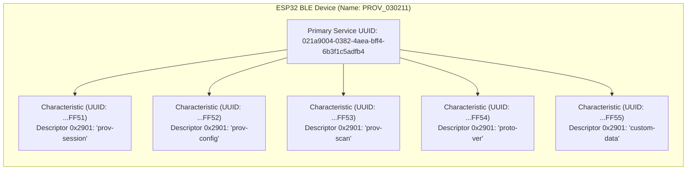
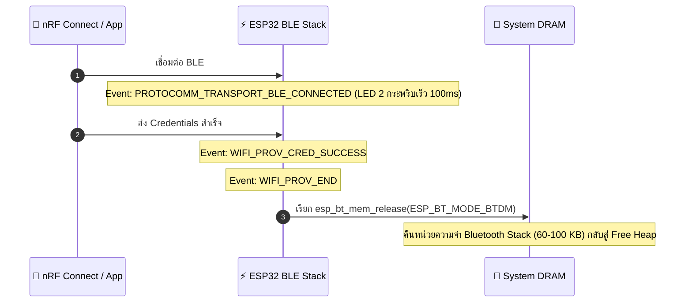

### ผลลัพธ์จาก Serial Monitor (ESP-IDF Console)

```text
I (712) wifi_prov_scheme_ble: Starting BLE provisioning
I (722) app: Starting provisioning
I (732) app: BLE Advertising as 'PROV_030211'
I (14500) app: BLE connected!
I (18200) app: Secured session established!
I (21300) app: Received Wi-Fi credentials (SSID: Lab_WiFi_2.4G)
I (24560) app: Provisioning successful
I (24570) wifi_prov_scheme_ble: BT memory released
I (24580) wifi_prov_scheme_ble: BTDM memory released
I (26120) app: Connected with IP Address: 192.168.1.155
```

---

### ผังโครงสร้าง GATT Tree และการคืนหน่วยความจำ Bluetooth

#### ภารกิจที่ 1: ผังโครงสร้าง GATT Tree & Endpoint Mapping



#### ภารกิจที่ 2: ผังลำดับการคืนหน่วยความจำ Bluetooth



---

### ตารางบันทึกผลการทดลอง

| รายการตรวจสอบ | ผลการทดลอง / ข้อมูลที่สังเกตได้ |
| :--- | :--- |
| **1. BLE Device Name ที่สแกนเจอ** | `PROV_030211` |
| **2. Primary Service UUID (128-bit)** | `021a9004-0382-4aea-bff4-6b3f1c5adfb4` |
| **3. Characteristic Endpoint ที่พบ (0x2901)** | 1. `prov-session`<br/>2. `prov-config`<br/>3. `custom-data` |
| **4. พฤติกรรมไฟ LED 2 (GPIO 4) ช่วงรอ vs ช่วงต่อ BLE** | ช่วงรอ: กระพริบช้า 500ms<br/>ช่วงต่อ: กระพริบเร็ว 100ms |
| **5. พฤติกรรมเมื่อต่อ Wi-Fi สำเร็จ** | มี Log คืนหน่วยความจำ Bluetooth (`BTDM memory released`) |

---

### คำถามท้ายการทดลอง (Post-Lab Questions)

#### 1. เหตุใด BLE Provisioning จึงไม่ส่งผลให้สัญญาณ Wi-Fi บนสมาร์ตโฟนของผู้ใช้หลุดระหว่างทำรายการ?
**ตอบ:** เพราะการสื่อสารทำผ่านคลื่นความถี่บลูทูธ (Bluetooth Low Energy) โดยตรงระหว่างมือถือกับ ESP32 จึงไม่ต้องเปลี่ยนการเชื่อมต่อ Wi-Fi ของมือถือ ทำให้มือถือยังคงใช้งานอินเทอร์เน็ตได้ตามปกติ

#### 2. Descriptor `0x2901` มีความสำคัญอย่างไรต่อการที่แอปพลิเคชันมือถือจะทราบว่า Characteristic แต่ละตัวใช้ทำหน้าที่อะไร?
**ตอบ:** ทำหน้าที่เก็บข้อความอธิบาย (User Description) ในรูปแบบ String เพื่อบอกชื่อฟังก์ชันของแต่ละ Characteristic (เช่น `prov-session`, `prov-config`) ทำให้แอปพลิเคชันมือถือสามารถจับคู่ Endpoint ในการส่งข้อมูลได้อย่างถูกต้องโดยไม่ต้องจำหมายเลข UUID แบบคงที่

#### 3. การที่ ESP-IDF มีฟังก์ชัน `esp_bt_mem_release()` มีประโยชน์อย่างไรต่อการทำงานของแอปพลิเคชัน IoT หลังเชื่อมต่อ Wi-Fi สำเร็จ?
**ตอบ:** ช่วยคืนพื้นที่หน่วยความจำ RAM ของ Bluetooth Controller และ Host Stack (ประมาณ 60–100 KB) กลับคืนสู่ระบบ DRAM ทำให้แอปพลิเคชันหลักมี RAM เพียงพอสำหรับงานประมวลผลและการเชื่อมต่อ Wi-Fi ต่อไป
