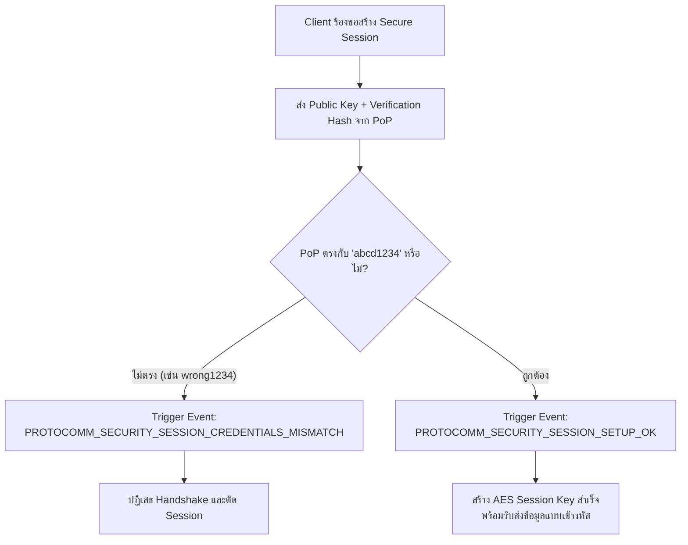
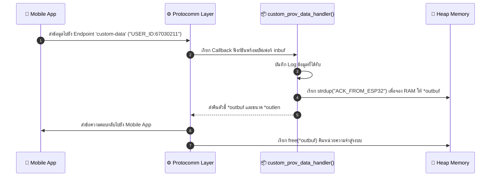

### ผลลัพธ์จาก Serial Monitor (ESP-IDF Console)

```text
I (1200) LAB7_4_SECURITY: Custom Endpoint 'custom-data' created.
I (1210) LAB7_4_SECURITY: Starting Provisioning with Security 1 (PoP required)
E (15600) app: Received incorrect username and/or PoP for establishing secure session!
I (18200) app: Secured session established!
I (22150) app: Received custom data: USER_ID:67030211
I (22160) LAB7_4_SECURITY: Response sent: ACK_FROM_ESP32
```

---

### ผังขั้นตอนการตรวจสอบ PoP และการรับส่ง Custom Data

#### ภารกิจที่ 1: ผังขั้นตอนการตรวจสอบ PoP (Security Handshake Decision Flow)



#### ภารกิจที่ 2: ผังการรับส่งข้อมูลผ่าน Custom Endpoint



---

### ตารางบันทึกผลการทดลอง

| สถานการณ์ทดสอบ | ค่า PoP ที่ป้อน | ผลลัพธ์บนแอปมือถือ | ข้อความ Log ใน Serial Monitor |
| :--- | :--- | :--- | :--- |
| **1. ป้อน PoP ผิดพลาด** | `wrong1234` | แสดงข้อความล้มเหลว (Session Failed) | `E (15600) app: Received incorrect username and/or PoP for establishing secure session!` |
| **2. ป้อน PoP ถูกต้อง** | `abcd1234` | ยืนยันความปลอดภัยสำเร็จ เข้าสู่หน้าเลือก Wi-Fi | `I (18200) app: Secured session established!` |
| **3. ส่ง Custom Data** | `USER_ID:67030211` | ได้รับข้อความตอบกลับ `ACK_FROM_ESP32` | `I (22150) app: Received custom data: USER_ID:67030211` |

---

### คำถามท้ายการทดลอง (Post-Lab Questions)

#### 1. การใช้ Proof-of-Possession (PoP) ช่วยป้องกันการโจมตีประเภทใดได้บ้าง?
**ตอบ:** ป้องกันการโจมตีแบบ Man-in-the-Middle (MitM) และ Rogue Provisioning (ผู้ไม่ประสงค์ดีที่อยู่ใกล้เคียงแอบเชื่อมต่อเพื่อส่งรหัส Wi-Fi แปลกปลอม หรือดักจับข้อมูลการตั้งค่า)

#### 2. หากไม่มีการใช้ PoP (เช่น ใน Security 0) ผู้โจมตีที่อยู่ในรัศมีสัญญาณบลูทูธสามารถทำสิ่งใดกับอุปกรณ์ได้บ้าง?
**ตอบ:** สามารถเชื่อมต่อเข้ามาสั่ง Provisioning ส่งข้อมูล Wi-Fi หรือดักอ่านข้อมูลที่รับส่งระหว่างอุปกรณ์ได้โดยไม่มีการเข้ารหัส ทำให้สามารถยึดครองอุปกรณ์หรือดักรหัสผ่านได้

#### 3. ในการประยุกต์ใช้งานเชิงพาณิชย์จริง เราสามารถนำ Custom Data Endpoint ไปใช้ส่งข้อมูลประเภทใดได้อีกบ้าง (ยกตัวอย่าง 2 กรณี)?
**ตอบ:** 1) ส่ง URL และ Token สำหรับเชื่อมต่อกับ Cloud MQTT Broker ของผู้ใช้งาน 2) ส่งรหัสลงทะเบียนประจำตัวอุปกรณ์ (Device Activation Code หรือ User Account ID)

#### 4. ในฟังก์ชัน `custom_prov_data_handler()` เหตุใดหน่วยความจำที่จัดสรรให้ `*outbuf` จึงถูก Free โดย Protocomm Layer อัตโนมัติหลังจากส่งข้อมูลเสร็จ?
**ตอบ:** เป็นการออกแบบเพื่อป้องกันปัญหา Memory Leak เนื่องจากขนาดข้อมูลตอบกลับมีความไม่แน่นอน Handler จึงสร้างข้อมูลบน Heap Memory และส่งต่อกรรมสิทธิ์ (Ownership) ให้ Protocomm Layer เป็นผู้ส่งข้อมูลเสร็จแล้วสั่ง `free()` ทิ้ง
